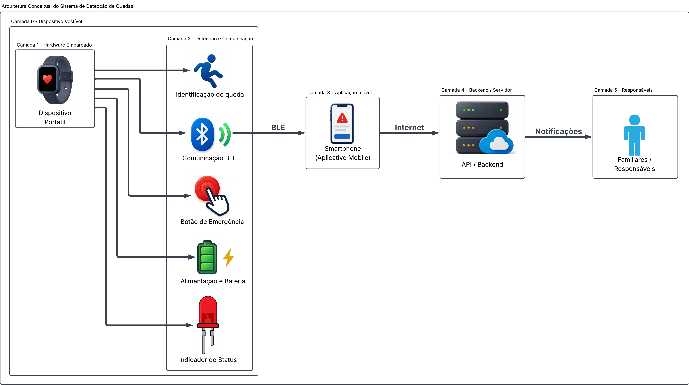
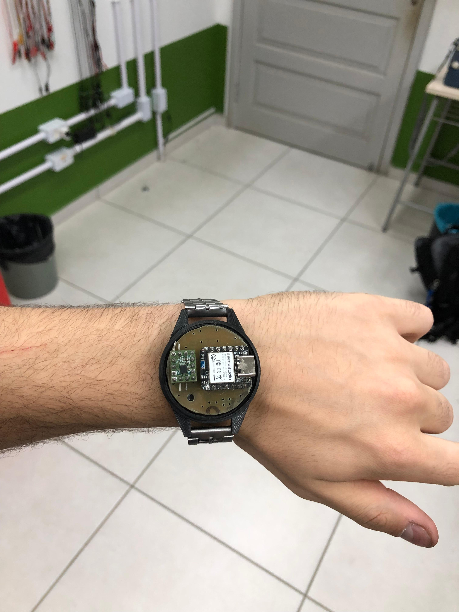

# SysCare - Sistema Portátil de Detecção de Quedas e Emergências de Pessoas

O projeto consiste em conceber, desenvolver, implementar e operar um dispositivo portátil, pequeno e de baixo consumo, semelhante a um relógio ou pulseira, capaz de identificar quedas e acidentes de uma pessoa e que tenha a capacidade de enviar um alerta para familiares ou responsáveis.

## Etapas do projeto 

O projeto foi desenvolvido utilizando a iniciativa CDIO, um framework educacional baseado na aprendizagem ativa com foco na resolução de problemas. Mais informações estão disponíveis no site oficial da iniciativa: http://www.cdio.org/). Baseado nas etapas do CDIO, o projeto está dividido nos seguintes tópicos:

- [Etapa 1](./etapa_1/README.md) (10/09/2026): Pesquisa, planejamento e outline do projeto.
- [Etapa 2](./etapa_2/README.md) (01/10/2026): Teste dos módulos e desenvolvimento de protótipo.
- [Etapa 3](./etapa_3/README.md) (05/11/2026): Desenvolvimento do produto.
- [Etapa 4](./etapa_4/README.md) (10/12/2026): Implementação e análise de desempenho.

## Requisitos

Este projeto deve implementar:

- Microcontrolador; 
- Comunicação Bluetooth Low Energy.
- Unidade de medição inercial (IMU) de 6 eixos.
- Desenvolvimento do aplicativo móvel.
- *Application Programming Interface* (API).

## Visão geral

  
  
Figura 1 - Diagrama de blocos do sistema

O sistema funciona em fluxo contínuo iniciando no Dispositivo Vestível (Camada 0) e seu *Hardware* Embarcado (Camada 1), onde a Camada 2 (Detecção e Comunicação) monitora os movimentos via algoritmos de detecção de queda, gerencia o botão de emergência, a bateria e o status luminoso, enviando os alertas via BLE para a Camada 3 (Aplicação Móvel/Smartphone); em seguida, o aplicativo repassa esses dados pela internet até a Camada 4 (Backend/Servidor) para processamento via API, resultando no disparo de notificações para a Camada 5 (Familiares/Responsáveis) prestarem o auxílio necessário.

## Protótipo

O primeiro protótipo da Pulseira SysCare, apresentado na Figura 2, reúne na carcaça impressa em 3D a placa de circuito impresso com o microcontrolador XIAO nRF52840 e o acelerômetro IIM-42351. A queda detectada pelo acelerômetro é anunciada por BLE com assinatura; o celular que recebe o anúncio toca o alarme e repassa o alerta ao servidor na nuvem, que avisa os responsáveis por *push*, além do SMS enviado pelo próprio celular. O desenvolvimento e os testes do protótipo estão descritos na [Etapa 3](./etapa_3/README.md).

  
  
Figura 2 - Primeiro protótipo da Pulseira SysCare

