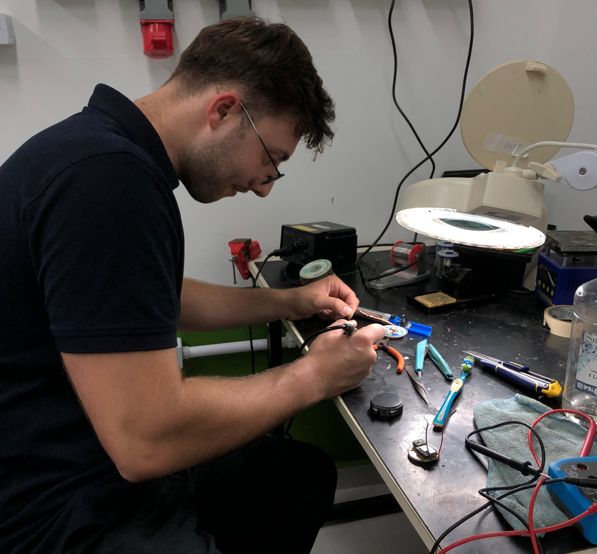
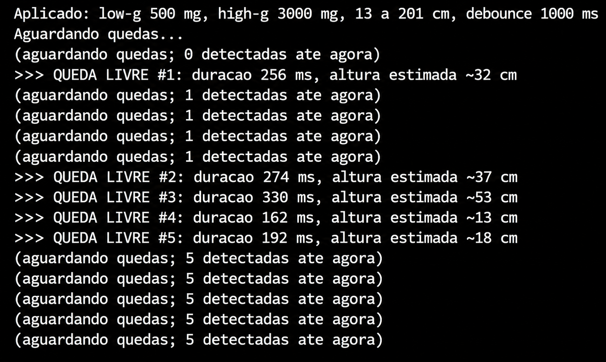
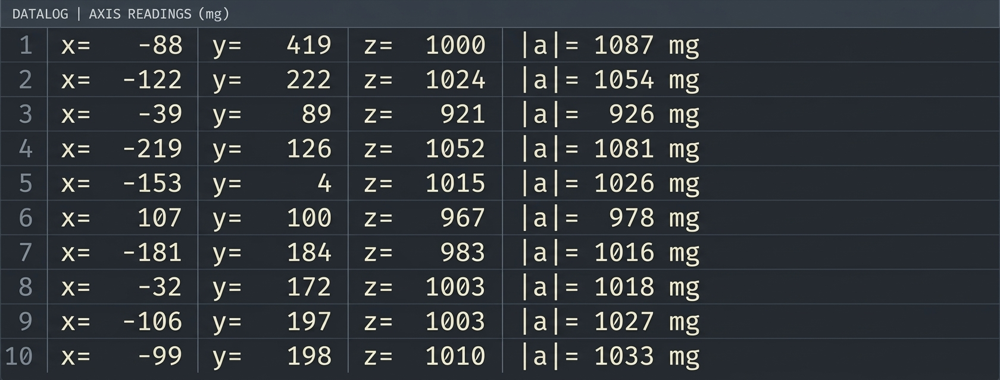
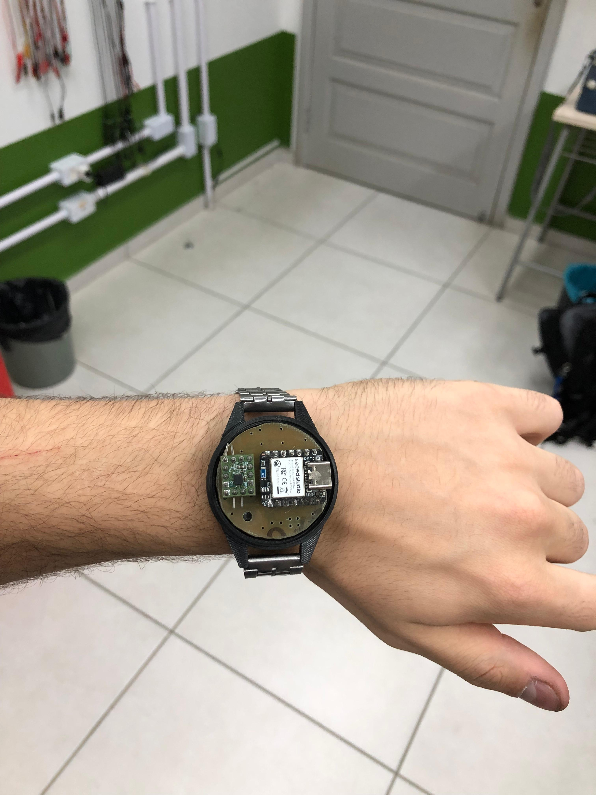
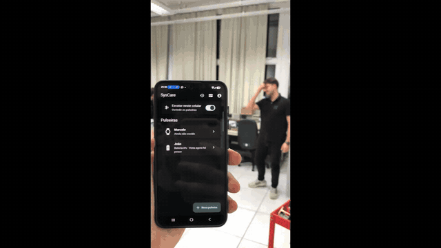

# Etapa 3

A Etapa 3 corresponde ao desenvolvimento e à implementação do produto, contemplando a fabricação das primeiras peças físicas da Pulseira SysCare e a integração inicial entre a pulseira, o aplicativo e o servidor.

Nesta etapa, a placa de circuito impresso (PCI) foi fabricada, a carcaça foi produzida por impressão 3D e o firmware passou a detectar quedas utilizando o acelerômetro IIM-42351. A pulseira também passou a transmitir os eventos detectados pelo protocolo SysCare, permitindo a integração com o aplicativo e o servidor.

O sistema ganhou notificações remotas por push, utilizando o Firebase Cloud Messaging (FCM), e a API foi publicada em uma máquina virtual na nuvem, permitindo o envio de alertas aos responsáveis independentemente da rede local.

Este documento apresenta o desenvolvimento de cada área, os testes realizados e os resultados obtidos. O detalhamento de cada implementação está disponível na documentação específica indicada ao final das respectivas seções.

## Desenvolvimento de Hardware

A placa de circuito impresso (PCI) foi produzida a partir do esquemático desenvolvido na Etapa 2, utilizando o processo de transferência do layout, corrosão do cobre e acabamento mecânico.

Inicialmente, o layout foi transferido para a placa, permitindo a definição das trilhas e das regiões de cobre. Em seguida, foi realizada a corrosão para remover o cobre excedente, formando as trilhas do circuito. Por fim, o lixamento foi utilizado para ajustar as dimensões da placa e permitir seu encaixe na carcaça.

A Figura 1 apresenta algumas das etapas de fabricação da PCI, incluindo a placa após a corrosão, o ajuste mecânico por lixamento e a soldagem dos componentes.

  
  
  

  
Figura 1 - Etapas de fabricação da placa de circuito impresso

Após a fabricação da placa, foram soldados os componentes necessários para os testes iniciais, incluindo o microcontrolador XIAO nRF52840, o acelerômetro IIM-42351 e a bateria.

A montagem inicial permitiu validar o funcionamento dos componentes principais antes da integração completa do sistema.

> 📁 **Documentação de Hardware:** [Hardware](./hardware/README.md)
>
> Layout da placa, processo de fabricação e etapas de montagem.

---

## Desenvolvimento de Firmware

O firmware da pulseira é desenvolvido para a plataforma XIAO nRF52840 [1], utilizando o Zephyr RTOS e o nRF Connect SDK [2].

A arquitetura foi organizada em módulos, permitindo validar individualmente os componentes antes da integração. Inicialmente, foram realizados testes de comunicação BLE e, posteriormente, testes de comunicação e configuração do acelerômetro IIM-42351 [3].

A implementação foi estruturada em camadas de abstração de hardware (HAL), drivers, serviços e aplicações, permitindo separar o acesso aos periféricos da lógica de funcionamento da pulseira.

### Validação do acelerômetro

O acelerômetro IIM-42351 foi configurado para realizar a detecção de queda livre utilizando o recurso APEX.

Durante os testes, foram realizadas verificações de identificação do dispositivo, leitura dos dados de aceleração, leitura da FIFO, configuração das interrupções e validação do recurso de detecção de queda livre.

A Figura 2 apresenta os testes realizados no terminal durante a validação do acelerômetro.

  
  

  
Figura 2 - Testes de detecção de queda livre e leitura dos dados do acelerômetro

### Integração do firmware

Após a validação individual dos módulos, foi realizada a integração entre o acelerômetro e o sistema de comunicação BLE.

O firmware integrado detecta a queda livre utilizando o acelerômetro e transmite o evento por meio do protocolo SysCare. Quando não há uma queda detectada, a pulseira envia um *heartbeat* a cada 10 segundos, mantendo a comunicação com o aplicativo.

O pacote BLE utilizado possui 14 bytes, organizados da seguinte forma:

| Campo | Bytes | Descrição |
|---|---|---|
| Versão | [0] | Identificação da versão do protocolo |
| ID da pulseira | [1..4] | Identificador do dispositivo |
| Evento | [5] | Tipo de evento transmitido |
| Sequência | [6..7] | Identificador sequencial da queda |
| Bateria | [8] | Informação da bateria |
| Impacto | [9] | Informação de impacto |
| Assinatura HMAC | [10..13] | Assinatura de autenticação |

A Figura 3 apresenta a organização do pacote SysCare utilizado na comunicação entre a pulseira e o aplicativo.

  
Figura 3 - Estrutura do pacote SysCare de 14 bytes

A transmissão BLE é iniciada uma única vez. A cada evento, o conteúdo do anúncio é atualizado sem interromper a publicidade.

Quando uma queda é detectada, o firmware atualiza o evento e incrementa a sequência, que permanece armazenada na memória flash. Dessa forma, o identificador da última queda é preservado mesmo após o reinício da placa.

O protocolo também prevê os seguintes tipos de evento:

| Código | Evento |
|---|---|
| 0x00 | Teste |
| 0x01 | Queda |
| 0x02 | Botão de pânico |
| 0x03 | Imobilidade |
| 0x04 | Bateria baixa |
| 0x05 | Heartbeat |

A assinatura HMAC, baseada em SHA-256, é utilizada para autenticar os anúncios enviados pela pulseira. Os quatro últimos bytes do pacote são utilizados para transportar a assinatura, calculada com a chave gerada durante o cadastro do dispositivo.

O campo de impacto ainda utiliza um valor fixo nesta implementação, enquanto o acelerômetro fornece informações relacionadas à duração e à altura da queda livre.

> 📁 **Documentação de Firmware:** [Firmware](./firmware/README.md)
>
> Arquitetura, validação do acelerômetro, comunicação BLE e integração dos módulos.
---

## Desenvolvimento de *Software*

O código do aplicativo e da API foi trazido da Etapa 2 para esta etapa, e o sistema ganhou o aviso remoto por *push*, pelo Firebase Cloud Messaging [6]. Até então, o alerta chegava pela sirene e pelo SMS do celular que ouviu a pulseira. Com o *push*, a API notifica os celulares de todos os responsáveis vinculados à pulseira, mesmo longe dela, e o aplicativo toca a mesma sirene do alarme local.
A integração com a pulseira real exigiu ajustes: o aplicativo passou a procurar explicitamente o anúncio BLE legado, formato usado pela pulseira [7], e o *firmware* de referência passou a calcular a assinatura com a interface criptográfica atual do nRF Connect SDK.

Por fim, a API foi publicada em uma máquina virtual do Azure, obtida pelo programa para estudantes [8], com HTTPS e endereço fixo. Assim, os alertas chegam ao servidor e o *push* sai para os responsáveis de qualquer lugar, e não só da rede local.

  
Figura 4 - Organização do servidor na nuvem e caminho do alerta até o responsável

> 📁 **Documentação de Software:**
>
> - [Software](./software/README.md)
> - [Aplicativo](./software/app/README.md)
> - [API](./software/api/README.md)
> - [Servidor na nuvem](./software/api/docs/servidor_nuvem.md)

## Desenvolvimento Mecânico

A carcaça projetada na Etapa 2 foi fabricada por impressão 3D utilizando ABS, conforme o material e o processo disponíveis no IFSC.

A fabricação permitiu verificar fisicamente as dimensões externas da estrutura, o espaço destinado à placa de circuito impresso, à bateria e ao acelerômetro, além dos elementos de fixação da pulseira.

A estrutura foi desenvolvida considerando a utilização de uma pulseira de 18 mm e a possibilidade de realizar ajustes geométricos durante a montagem.

A Figura 5 apresenta a carcaça impressa em 3D e a montagem com a pulseira.

  
  

  
Figura 5 - Carcaça impressa em 3D e montagem com a pulseira

A impressão da estrutura permitiu avaliar o encaixe dos componentes e identificar ajustes necessários para as próximas etapas de fabricação.

> 📁 **Documentação de Mecânica:** [Mecânica](./mechanics/README.md)
>
> Fabricação, montagem e desenvolvimento da estrutura física da pulseira.

## Integração Total do Sistema

Após o desenvolvimento individual das áreas de hardware, firmware, software e mecânica, foi realizada a integração do sistema, resultando no primeiro protótipo funcional da Pulseira SysCare.

A integração permitiu reunir a placa de circuito impresso, o acelerômetro, a bateria, a estrutura mecânica e os componentes de software em um único dispositivo.

A Figura 6 apresenta o primeiro protótipo montado.

  

  
Figura 6 - Primeiro protótipo da Pulseira SysCare

Após a montagem, foram iniciados os testes de funcionamento e integração, com o objetivo de verificar a comunicação entre a pulseira, o aplicativo e o servidor.

## Testes do Protótipo

No primeiro teste de integração, em 22/10, o celular que ouviu a pulseira tocou a sirene e enviou o SMS ao responsável, mas a API recusou a queda, porque aquela versão do *firmware* não assinava o anúncio; sem a assinatura, o servidor não distingue a pulseira de um rádio que a imite.

Em 04/11, com o *firmware* integrado assinando os anúncios, a cadeia completa funcionou (Figura 7): a queda detectada pelo acelerômetro foi aceita pelo servidor na nuvem, o *push* chegou aos responsáveis e um deles, em outra rede, confirmou o atendimento em menos de 30 s. Os quiques da pulseira no chão geraram três alertas para a mesma queda, ponto a ser tratado na próxima etapa.

  
  
Figura 7 - Teste de 04/11/2026: alerta da queda detectada pelo acelerômetro, com impacto, bateria e opções de atendimento (<a href="./img/teste_pulseira_push.mp4">vídeo</a>)

Em 05/11, foi realizada a montagem do protótipo inicial da pulseira, seguida de testes de funcionamento. O Gif 1 mostra um desses testes: a queda é detectada pelo acelerômetro, a pulseira transmite o alerta por BLE, o aplicativo recebe a mensagem e o responsável é notificado por SMS. O resultado confirmou o funcionamento correto do protótipo completo.

  
  
Gif 1 - Teste de funcionamento do protótipo completo

## Próximos passos - Etapa 4

Nesta etapa, serão realizados os ajustes finais do projeto SysCare, contemplando melhorias no hardware, firmware, aplicativo e estrutura mecânica.

### Hardware (HW)
- Adicionar os componentes que ficaram pendentes no desenvolvimento do hardware.
- Validar o sistema por inteiro e fabricar a placa na china.

### Firmware (FW)
- Implementar a funcionalidade do botão de emergência e do LED.
- Refinar a detecção de quedas utilizando o acelerômetro.

### Aplicativo (App)
- Otimizar a interface do aplicativo, melhorando a experiência e a usabilidade.

### Mecânico (MEC)
- Realizar a manufatura da tampa.
- Desenvolver a entrada para carregamento.
- Realizar o acabamento da estrutura.

## Referências (links/datasheets/livros)

**Firmware e protocolo BLE**

[1] SEEED STUDIO. *Getting Started with Seeed Studio XIAO nRF52840 Series*. Disponível em: [https://wiki.seeedstudio.com/XIAO_BLE/](https://wiki.seeedstudio.com/XIAO_BLE/).

[2] NORDIC SEMICONDUCTOR. *nRF Connect SDK - Documentation*. Disponível em: [https://docs.nordicsemi.com/bundle/ncs-latest/page/nrf/index.html](https://docs.nordicsemi.com/bundle/ncs-latest/page/nrf/index.html).

[3] TDK INVENSENSE. *High-performance 3-Axis SmartIndustrial™ Accelerometer MEMS Device for Industrial Applications (IIM-42351)*. Disponível em: [https://product.tdk.com/system/files/dam/doc/product/sensor/mortion-inertial/accelero/data_sheet/ds-000441-iim-42351-typ-v1.2.pdf](https://product.tdk.com/system/files/dam/doc/product/sensor/mortion-inertial/accelero/data_sheet/ds-000441-iim-42351-typ-v1.2.pdf).

[4] BLUETOOTH SIG. *Core Specification Supplement - Advertising and Scan Response Data Format*. Disponível em: [https://www.bluetooth.com/specifications/specs/core-specification-supplement/](https://www.bluetooth.com/specifications/specs/core-specification-supplement/).

[5] KRAWCZYK, H.; BELLARE, M.; CANETTI, R. *RFC 2104 - HMAC: Keyed-Hashing for Message Authentication*. Disponível em: [https://datatracker.ietf.org/doc/html/rfc2104](https://datatracker.ietf.org/doc/html/rfc2104).

### Software

[6] GOOGLE. *Firebase Cloud Messaging - Documentation*. Disponível em: [https://firebase.google.com/docs/cloud-messaging](https://firebase.google.com/docs/cloud-messaging).

[7] ANDROID DEVELOPERS. *ScanSettings.Builder - setLegacy*. Disponível em: [https://developer.android.com/reference/android/bluetooth/le/ScanSettings.Builder](https://developer.android.com/reference/android/bluetooth/le/ScanSettings.Builder).

[8] MICROSOFT. *Azure for Students*. Disponível em: [https://azure.microsoft.com/en-us/free/students](https://azure.microsoft.com/en-us/free/students).
