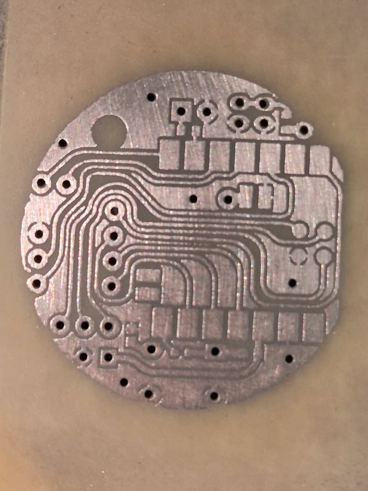
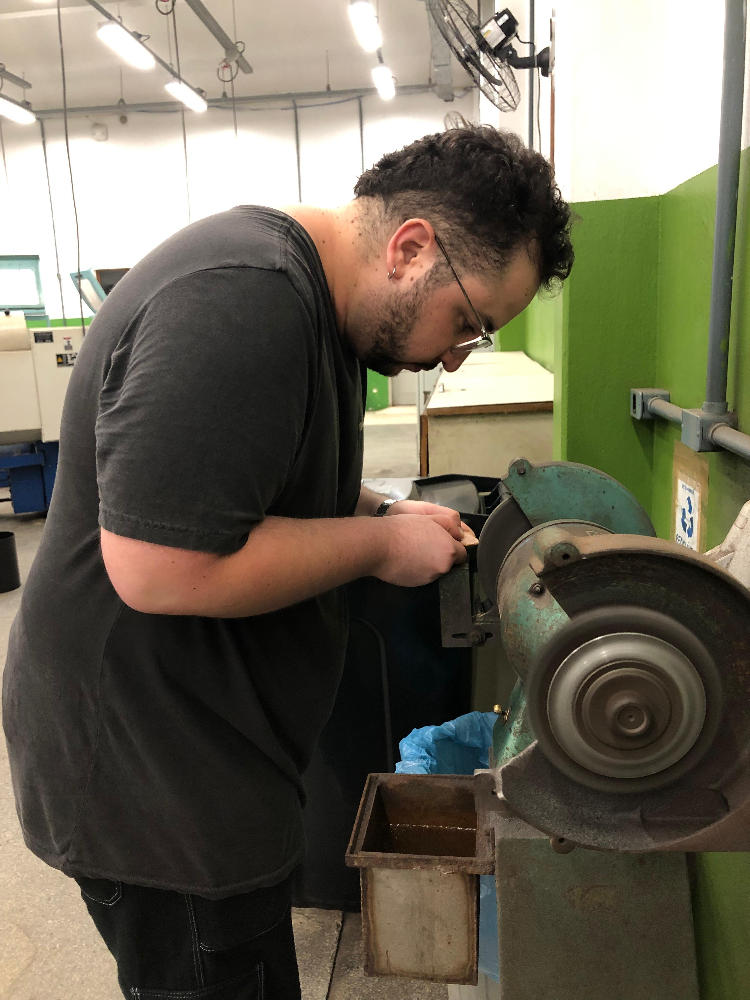
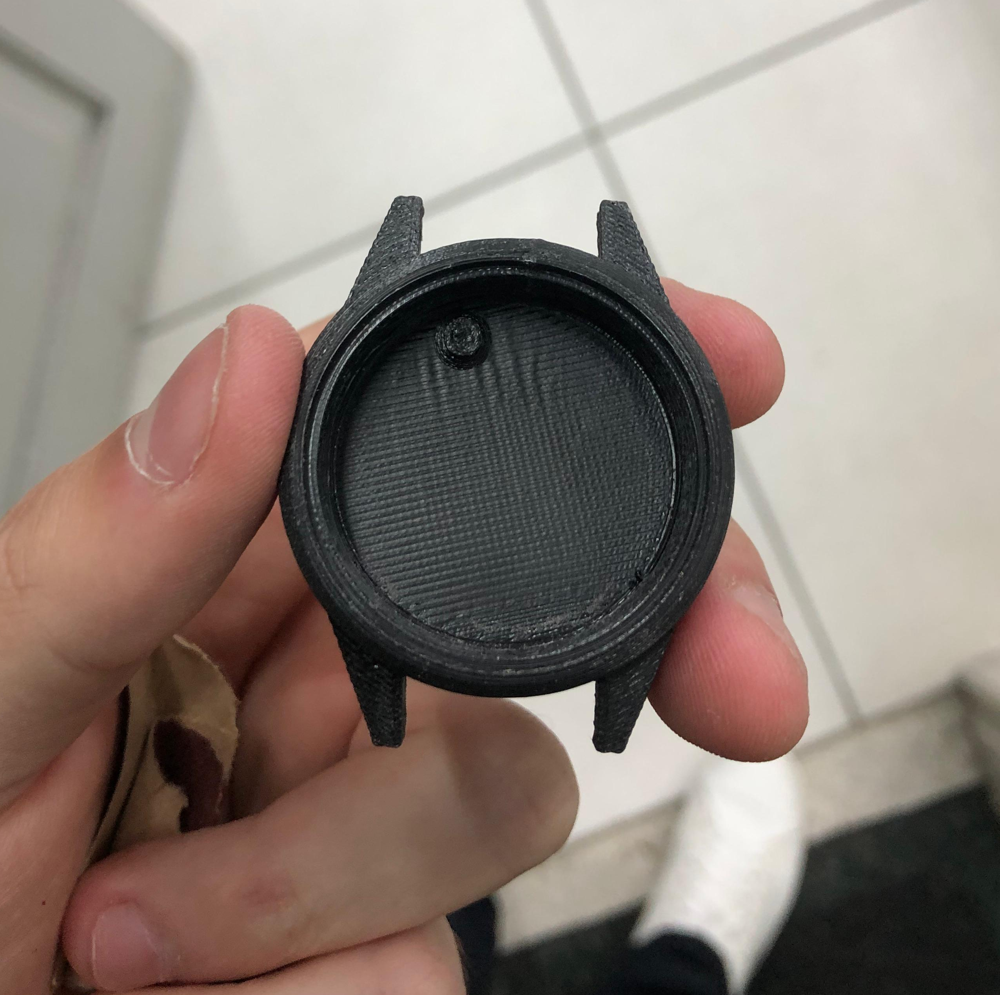
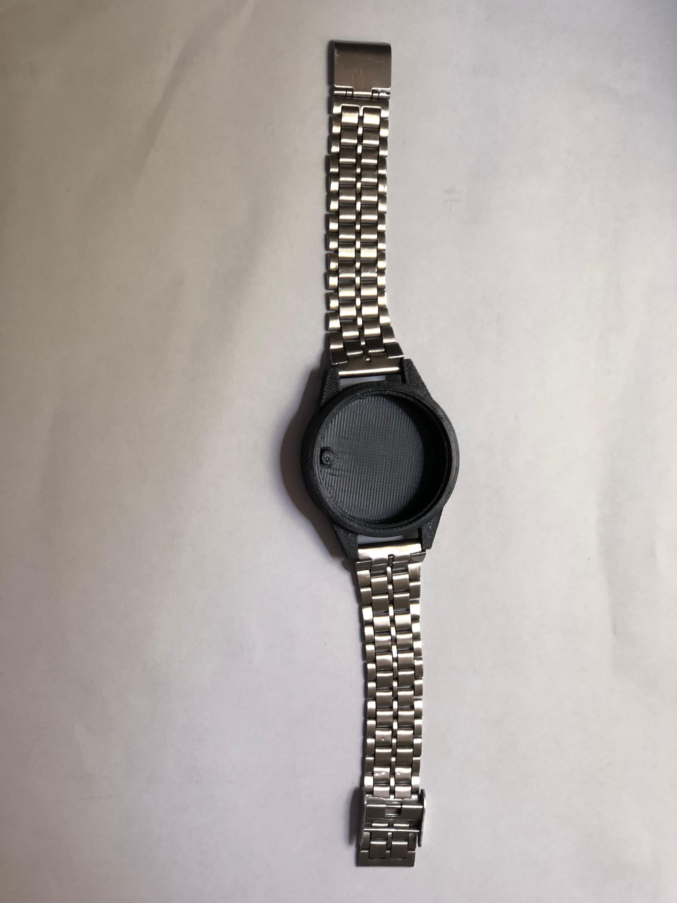
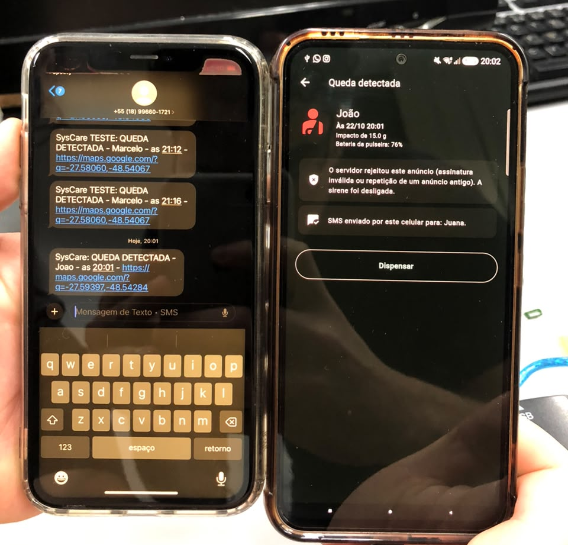
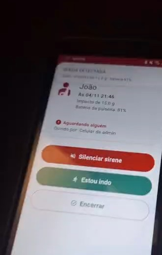

# Etapa 3

A etapa 3 corresponde ao desenvolvimento do produto: a fabricação das primeiras peças físicas da Pulseira SysCare e a primeira integração entre a pulseira, o aplicativo e o servidor. Nesta etapa, a placa de circuito impresso foi fabricada, a carcaça foi impressa em 3D, a pulseira passou a detectar a queda pelo acelerômetro e a anunciá-la pelo protocolo SysCare, o sistema ganhou o aviso remoto por *push* e a API passou a rodar na nuvem. Este documento resume cada frente; o detalhamento está nos documentos indicados ao final de cada seção.

---

## Desenvolvimento de *Hardware*

A placa de circuito impresso (PCI) foi produzida a partir do esquemático da Etapa 2, pelo processo de transferência do desenho e corrosão do cobre. O *layout* foi transferido para a placa, a corrosão formou as trilhas e o lixamento ajustou o formato para o encaixe na carcaça (Figura 1). As próximas atividades são a inspeção das trilhas, o teste de continuidade elétrica e a montagem dos componentes.

  
  
  
Figura 1 - Placa de circuito impresso após a corrosão e adequação por lixamento

> 📁 **Documentação de *Hardware*:** layout e etapas de fabricação em [Hardware](./hardware/README.md)

---

## Desenvolvimento de *Firmware*

O *firmware* da pulseira é desenvolvido para a XIAO nRF52840 [1], sobre o Zephyr RTOS e o nRF Connect SDK [2]. A estratégia adotada é validar cada módulo isoladamente antes de integrá-los: primeiro o anúncio BLE, depois a comunicação com o acelerômetro IIM-42351 [3] e, por fim, a aplicação integrada.

O *firmware* integrado já detecta a queda pelo próprio acelerômetro: o recurso de queda livre do IIM-42351 [3] identifica quedas de 13 cm a cerca de 2 m, seguidas de impacto acima de 3 g. Sem queda, a pulseira envia um *heartbeat* a cada 10 s. O pacote de 14 bytes do protocolo SysCare [4] é atualizado a cada evento, sem interromper a transmissão, e os quatro últimos bytes levam a assinatura HMAC [5], calculada com a chave gerada no cadastro da pulseira. O número de sequência só avança nas quedas e fica gravado na memória da placa, para que um reinício não faça o aplicativo e o servidor tomarem uma queda nova pela repetição de um anúncio antigo. O campo de impacto ainda leva um valor fixo, porque o sensor mede a duração da queda, e não a intensidade do impacto.

> 📁 **Documentação do *Firmware*:** [Firmware](./firmware/README.md) · **Protocolo BLE:** [ble_payload.md](./software/api/docs/ble_payload.md)

---

## Desenvolvimento de *Software*

O código do aplicativo e da API foi trazido da Etapa 2 para esta etapa, e o sistema ganhou o aviso remoto por *push*, pelo Firebase Cloud Messaging [6]. Até então, o alerta chegava pela sirene e pelo SMS do celular que ouviu a pulseira. Com o *push*, a API notifica os celulares de todos os responsáveis vinculados à pulseira, mesmo longe dela, e o aplicativo toca a mesma sirene do alarme local.
A integração com a pulseira real exigiu ajustes: o aplicativo passou a procurar explicitamente o anúncio BLE legado, formato usado pela pulseira [7], e o *firmware* de referência passou a calcular a assinatura com a interface criptográfica atual do nRF Connect SDK.

Por fim, a API foi publicada em uma máquina virtual do Azure, obtida pelo programa para estudantes [8], com HTTPS e endereço fixo. Assim, os alertas chegam ao servidor e o *push* sai para os responsáveis de qualquer lugar, e não só da rede local.

> 📁 **Documentação de *Software*:** [Software](./software/README.md) · [Aplicativo](./software/app/README.md) · [API](./software/api/README.md) · [Servidor na nuvem](./software/api/docs/servidor_nuvem.md)

---

## Desenvolvimento mecânico

A carcaça projetada na Etapa 2 foi fabricada por impressão 3D em ABS, com o filamento e o processo disponíveis no IFSC, como mostra a Figura 2. A peça permitiu verificar fisicamente as dimensões externas, a região reservada à placa, à bateria e ao acelerômetro, e os elementos de fixação da pulseira de 18 mm.

  
  
  
Figura 2 - Carcaça impressa em 3D e montagem com a pulseira

> 📁 **Documentação de Mecânica:** fabricação e montagem do *case* em [Mecânica](./mechanics/README.md)

---

## Testes

As validações desta etapa estão resumidas na Tabela 1.

| Área | Teste | Resultado |
|---|---|---|
| **Mecânica** | Impressão da carcaça e montagem com a pulseira | Geometria e fixação verificadas fisicamente |
| ***Hardware*** | Fabricação da PCI | Trilhas formadas; continuidade e montagem pendentes |
| ***Firmware*** | Detecção de queda livre e anúncio assinado | Quedas detectadas e aceitas pelo servidor |
| **Integração** | Pulseira sem assinatura, celular e responsável, em 22/10/2026 | Alarme e SMS ao responsável; queda recusada pela API |
| **Cadeia completa** | Queda real com o *firmware* assinado, em 04/11/2026 | Queda aceita, *push* entregue e atendimento confirmado por um responsável em outra rede |
| **Servidor** | API na nuvem: acesso por HTTPS e reinício da máquina | Respondeu por HTTPS e voltou sozinha em cerca de 18 s |
| **Automatizados** | 47 testes do aplicativo e 27 da API | Todos aprovados |

  
Tabela 1 - Testes realizados na Etapa 3

No primeiro teste de integração, em 22/10 (Figura 3), o celular que ouviu a pulseira tocou a sirene e enviou o SMS ao responsável, mas a API recusou a queda, porque aquela versão do *firmware* não assinava o anúncio; sem a assinatura, o servidor não distingue a pulseira de um rádio que a imite.

  
  
Figura 3 - Teste de 22/10/2026: à direita, o alarme no celular que ouviu a pulseira; à esquerda, o SMS recebido pelo responsável

Em 04/11, com o *firmware* integrado assinando os anúncios, a cadeia completa funcionou (Figura 4): a queda detectada pelo acelerômetro foi aceita pelo servidor na nuvem, o *push* chegou aos responsáveis e um deles, em outra rede, confirmou o atendimento em menos de 30 s. Os quiques da pulseira no chão geraram três alertas para a mesma queda, ponto a ser tratado na próxima etapa.

  
  
Figura 4 - Teste de 04/11/2026: alerta da queda detectada pelo acelerômetro, com impacto, bateria e opções de atendimento (<a href="./img/teste_pulseira_push.mp4">vídeo</a>)

## Referências (links/datasheets/livros)

**Firmware e protocolo BLE**

- [1] [SEEED STUDIO. Getting Started with Seeed Studio XIAO nRF52840 Series](https://wiki.seeedstudio.com/XIAO_BLE/)

- [2] [NORDIC SEMICONDUCTOR. nRF Connect SDK - Documentation](https://docs.nordicsemi.com/bundle/ncs-latest/page/nrf/index.html)

- [3] [TDK INVENSENSE. High-performance 3-Axis SmartIndustrial™ Accelerometer MEMS Device for Industrial Applications (IIM-42351)](https://product.tdk.com/system/files/dam/doc/product/sensor/mortion-inertial/accelero/data_sheet/ds-000441-iim-42351-typ-v1.2.pdf)

- [4] [BLUETOOTH SIG. Core Specification Supplement - Advertising and Scan Response Data Format](https://www.bluetooth.com/specifications/specs/core-specification-supplement/)

- [5] [KRAWCZYK, H.; BELLARE, M.; CANETTI, R. RFC 2104 - HMAC: Keyed-Hashing for Message Authentication](https://datatracker.ietf.org/doc/html/rfc2104)

**Software**

- [6] [GOOGLE. Firebase Cloud Messaging - Documentation](https://firebase.google.com/docs/cloud-messaging)

- [7] [ANDROID DEVELOPERS. ScanSettings.Builder - setLegacy](https://developer.android.com/reference/android/bluetooth/le/ScanSettings.Builder)

- [8] [MICROSOFT. Azure for Students](https://azure.microsoft.com/en-us/free/students)
