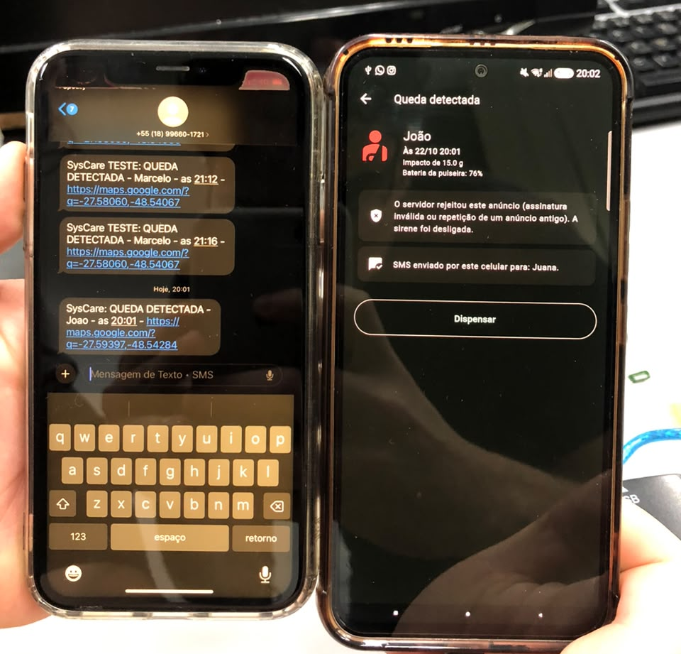
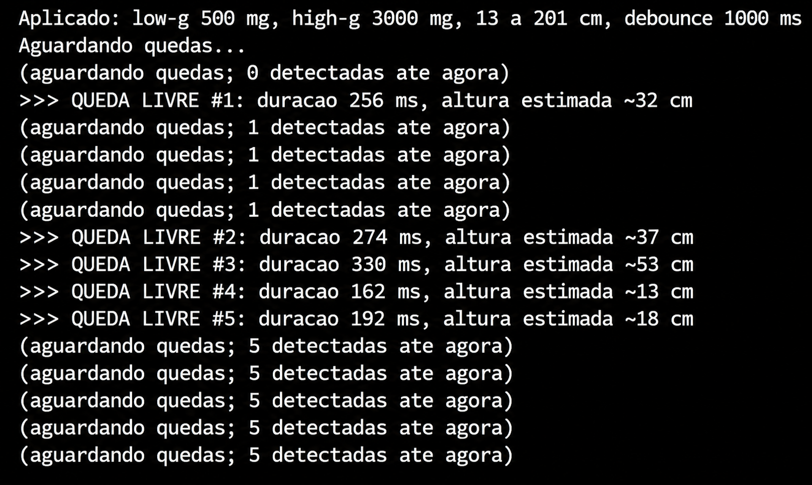
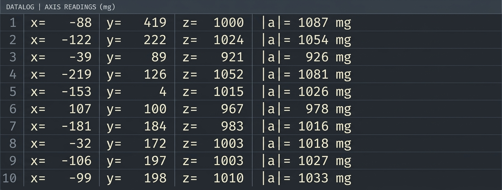
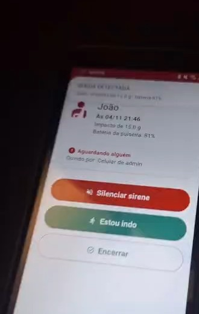
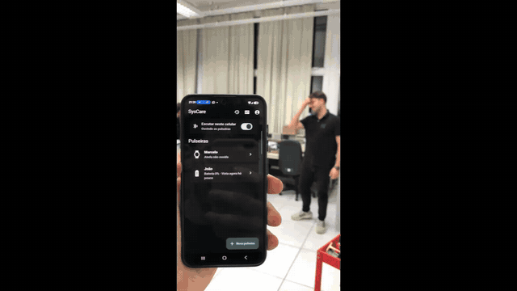

# SysCare - Firmware da Pulseira

## 1. Visão geral

O firmware da pulseira SysCare é desenvolvido para a placa **Seeed Studio XIAO nRF52840**, utilizando o nRF Connect SDK (NCS) 3.4 e o sistema operacional Zephyr RTOS [1].

O desenvolvimento foi dividido em três aplicações, que compartilham um módulo comum:

- **ble_advertising**: testes da comunicação Bluetooth Low Energy (BLE), com o advertising e o protocolo de dados, usando quedas simuladas.
- **acc_validation**: testes da comunicação com o acelerômetro IIM-42351 [2] e dos seus recursos de detecção de queda.
- **firmware integrado** (raiz da pasta): reúne a comunicação BLE e o acelerômetro em uma única aplicação, que é a gravada na pulseira.

A estratégia foi validar cada componente individualmente antes da integração, facilitando a depuração e a identificação de problemas.

## 2. Estrutura do repositório

A organização da pasta `etapa_3/firmware` está resumida na Tabela 1.

| Pasta | Conteúdo |
|---|---|
| raiz (`src/`, `prj.conf`, `app.overlay`) | Firmware integrado: acelerômetro e advertising BLE assinado |
| `ble_advertising/` | Teste do advertising BLE com quedas simuladas |
| `acc_validation/` | Validação do acelerômetro, em cinco fases |
| `lib/` | Módulo compartilhado: driver do IIM-42351, acesso ao SPI e ao GPIO, serviço do acelerômetro e a ligação dos pinos no devicetree |

Tabela 1 - Organização da pasta do firmware

## 3. Testes individuais

### 3.1. Testes do Bluetooth Low Energy

Esta etapa teve como objetivo validar a inicialização do Bluetooth, a transmissão de dados por advertising e o protocolo de comunicação SysCare, antes da integração com o acelerômetro.

#### Protocolo SysCare BLE

O payload possui 14 bytes, organizados conforme a Tabela 2. Os campos de 16 bits são transmitidos em little-endian.

| Bytes | Campo | Descrição |
|---|---|---|
| `[0]` | Versão | Versão do protocolo (`0x01`) |
| `[1..4]` | ID da pulseira | Identificador de 32 bits do dispositivo |
| `[5]` | Evento | Tipo de evento transmitido (Tabela 3) |
| `[6..7]` | Sequência | Número do último evento: só avança na queda, e o heartbeat repete o valor |
| `[8]` | Bateria | Nível de bateria, em % |
| `[9]` | Impacto | Intensidade do impacto, em décimos de g |
| `[10..13]` | Assinatura | HMAC-SHA256 dos bytes 0 a 9, truncado em 4 bytes [3] |

Tabela 2 - Payload do protocolo SysCare BLE

| Código | Evento |
|---|---|
| `0x00` | Teste |
| `0x01` | Queda |
| `0x02` | Botão de pânico |
| `0x03` | Imobilidade |
| `0x04` | Bateria baixa |
| `0x05` | Heartbeat |

Tabela 3 - Tipos de evento

#### Funcionamento do advertising

O advertising é iniciado uma única vez; depois disso, os dados são atualizados a cada evento, sem interromper a transmissão. No teste da pasta `ble_advertising`, as quedas eram simuladas e os quatro bytes finais ainda não levavam a assinatura.

Com esse código, foi feito um teste em conjunto com o aplicativo, em 22/10/2026 (Figura 1). O celular identificou a queda transmitida por BLE, tocou o alarme e enviou o SMS ao responsável. O servidor, porém, recusou o alerta, porque o anúncio não estava assinado.

  
  
Figura 1 - Teste do advertising BLE com o aplicativo: alarme no celular e SMS recebido pelo responsável

### 3.2. Testes do acelerômetro

Esta etapa foi dedicada à comunicação com o acelerômetro **TDK IIM-42351** [2], ligado à placa pelo barramento SPI. A validação foi feita de forma incremental, em cinco fases, antes da integração com o BLE:

1. **Identificação (WHO_AM_I):** leitura do registrador de identificação, para confirmar que a comunicação SPI está funcionando.
2. **Leitura em mg:** leitura das acelerações nos três eixos, convertidas para mg, conferindo os valores com a placa em repouso (módulo próximo de 1000 mg).
3. **Leitura em FIFO:** leitura das amostras pela FIFO do sensor, em vez de leitura direta dos registradores, reduzindo o trabalho do microcontrolador.
4. **Interrupções:** configuração do pino de interrupção do sensor, para que o nRF52840 seja avisado de um evento sem precisar ler o sensor continuamente.
5. **Queda livre (APEX):** uso do detector de queda livre do próprio sensor para identificar quedas e medir a sua duração.

#### Detecção de queda livre

A detecção é feita pelo recurso APEX do IIM-42351. Durante uma queda livre, a aceleração medida cai para perto de zero; ao final, o impacto causa um pico de aceleração. O sensor usa dois limiares para reconhecer essas duas fases e, ao concluir a detecção, sinaliza o evento por interrupção. Os parâmetros aplicados estão na Tabela 4.

| Parâmetro | Valor | Função |
|---|---|---|
| Início (low-g) | 500 mg | A queda livre começa quando a aceleração cai abaixo desse valor |
| Impacto (high-g) | 3000 mg | A queda termina com uma aceleração acima desse valor |
| Altura | 13 a 201 cm | Quedas fora dessa faixa são descartadas |
| Debounce | 1000 ms | Após uma detecção, novos eventos são ignorados nesse intervalo |

Tabela 4 - Parâmetros da detecção de queda livre

A saída é a **duração** da queda livre e a **altura estimada** por ela, pela relação da queda livre sem resistência do ar:

h = (g · t²) / 2

#### Resultados

Com a placa em repouso, as leituras dos três eixos resultaram em módulo próximo de 1000 mg, como esperado para a aceleração da gravidade. O teste de queda consistiu em soltar a placa sobre uma almofada, para proteger o hardware, e observar o resultado no terminal serial. A Figura 2 mostra os dois registros: foram detectadas 5 quedas livres, com o contador atualizado a cada evento (Tabela 5). As alturas estimadas ficaram dentro da faixa configurada, e o módulo mostrou-se capaz de detectar a queda e medir a sua duração.

| Queda | Duração (ms) | Altura estimada (cm) |
|---|---|---|
| 1 | 256 | ~32 |
| 2 | 274 | ~37 |
| 3 | 330 | ~53 |
| 4 | 162 | ~13 |
| 5 | 192 | ~18 |

Tabela 5 - Quedas livres registradas

  
  
  
Figura 2 - Testes de detecção de queda livre e leitura dos dados do acelerômetro

## 4. Firmware integrado

A aplicação da raiz da pasta reúne os módulos validados: a comunicação BLE (seção 3.1) e a detecção de queda pelo acelerômetro (seção 3.2). Com a integração, os eventos de queda passaram a ser gerados pela detecção real do sensor.

### 4.1. Funcionamento

A integração é baseada em interrupção, o que dispensa a leitura contínua do sensor e reduz o consumo, requisito importante para um dispositivo vestível:

1. O IIM-42351 detecta a queda livre pelo recurso APEX, com os parâmetros da Tabela 4, e sinaliza o evento no pino INT1, ligado ao pino D2 da XIAO.
2. O nRF52840 recebe a interrupção e apenas agenda um trabalho na fila de trabalhos do sistema (work queue), mantendo a rotina de interrupção curta.
3. Fora da interrupção, o firmware lê o status do sensor, confirma a queda e obtém a duração e a altura estimada.
4. A aplicação monta o payload com o evento **Queda (`0x01`)**, avança o número de sequência, grava-o na memória flash e calcula a assinatura com a chave gerada no cadastro da pulseira. O campo de impacto ainda leva um valor fixo de 15,0 g, porque o sensor mede a duração da queda, e não a intensidade do impacto.
5. O payload é publicado sem reiniciar o advertising. Sem queda, a pulseira envia um heartbeat a cada 10 s.

O número de sequência identifica cada ocorrência: o aplicativo e o servidor reconhecem as retransmissões da mesma queda e alarmam uma única vez. Como fica gravado na flash, ele continua válido depois de um reinício da pulseira. A assinatura impede que outro rádio imite a pulseira e dispare um alerta falso.

### 4.2. Resultados

Em 04/11/2026, a queda detectada pelo acelerômetro foi transmitida já assinada, aceita pelo servidor na nuvem e entregue por *push* aos responsáveis; um deles, em outra rede, confirmou o atendimento em menos de 30 s (Figura 3). Os quiques da pulseira no chão geraram três alertas para a mesma queda, já que o debounce de 1 s é curto para esse caso.

  
  
Figura 3 - Alerta da queda detectada pelo acelerômetro, recebido no celular (<a href="../img/teste_pulseira_push.mp4">vídeo</a>)

Em 05/11/2026, com o protótipo da pulseira montado, o teste foi repetido: a queda foi detectada, transmitida por BLE e recebida pelo aplicativo, e o responsável foi avisado por SMS (Gif 1).

  
  
Gif 1 - Teste de funcionamento do protótipo completo

### 4.3. Próximos passos

- Ignorar novas quedas por alguns segundos depois de uma detecção, para que os quiques não gerem alertas repetidos.
- Medir a intensidade real do impacto e ler o nível real da bateria.
- Implementar os eventos de botão de pânico, imobilidade e bateria baixa, que já têm códigos reservados no protocolo.
- Anunciar a cada 2 s em repouso e a cada 100 ms só na emergência, como prevê o protocolo, para reduzir o consumo.

## Referências (links/datasheets/livros)

- [1] [NORDIC SEMICONDUCTOR. nRF Connect SDK - Documentation](https://docs.nordicsemi.com/bundle/ncs-latest/page/nrf/index.html)

- [2] [TDK INVENSENSE. High-performance 3-Axis SmartIndustrial™ Accelerometer MEMS Device for Industrial Applications (IIM-42351)](https://product.tdk.com/system/files/dam/doc/product/sensor/mortion-inertial/accelero/data_sheet/ds-000441-iim-42351-typ-v1.2.pdf)

- [3] [KRAWCZYK, H.; BELLARE, M.; CANETTI, R. RFC 2104 - HMAC: Keyed-Hashing for Message Authentication](https://datatracker.ietf.org/doc/html/rfc2104)
