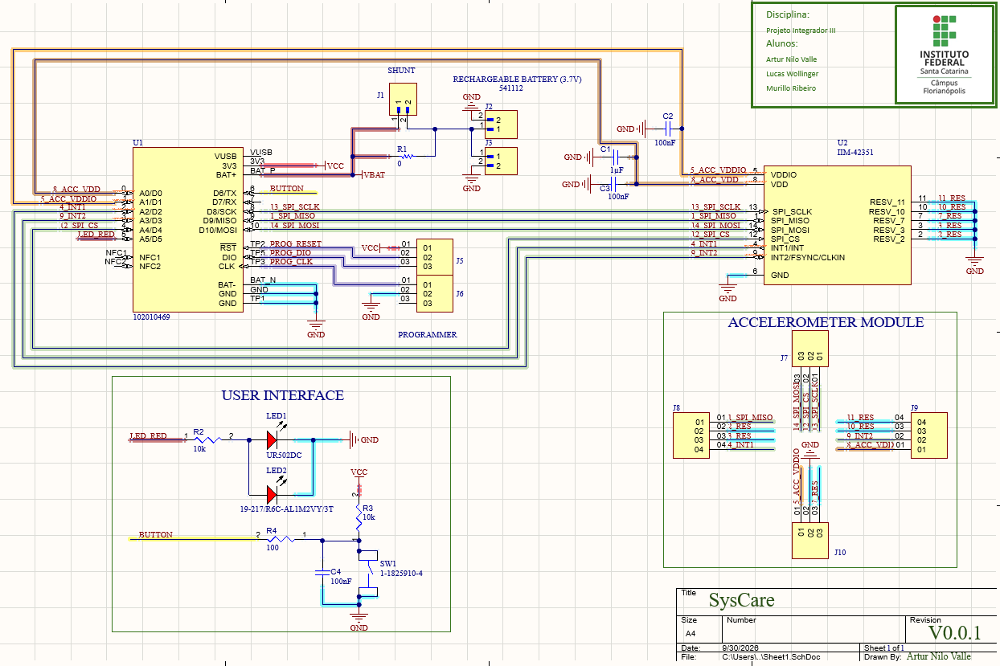
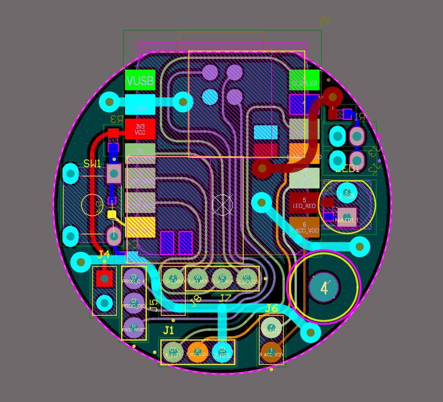
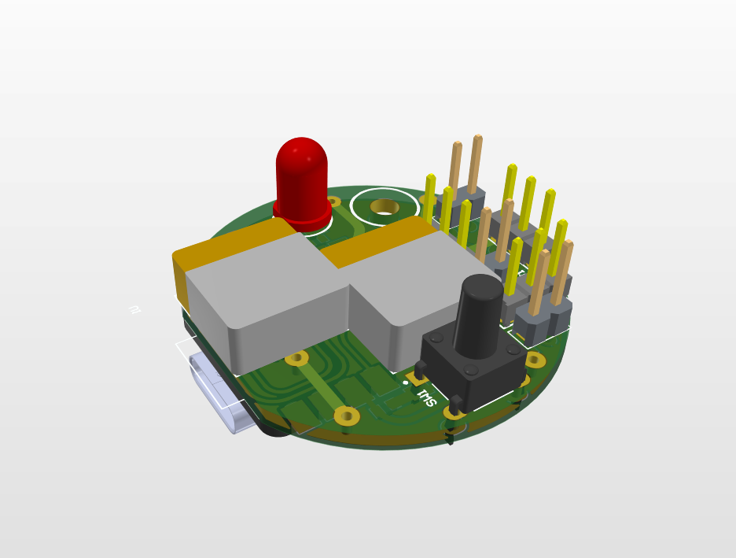
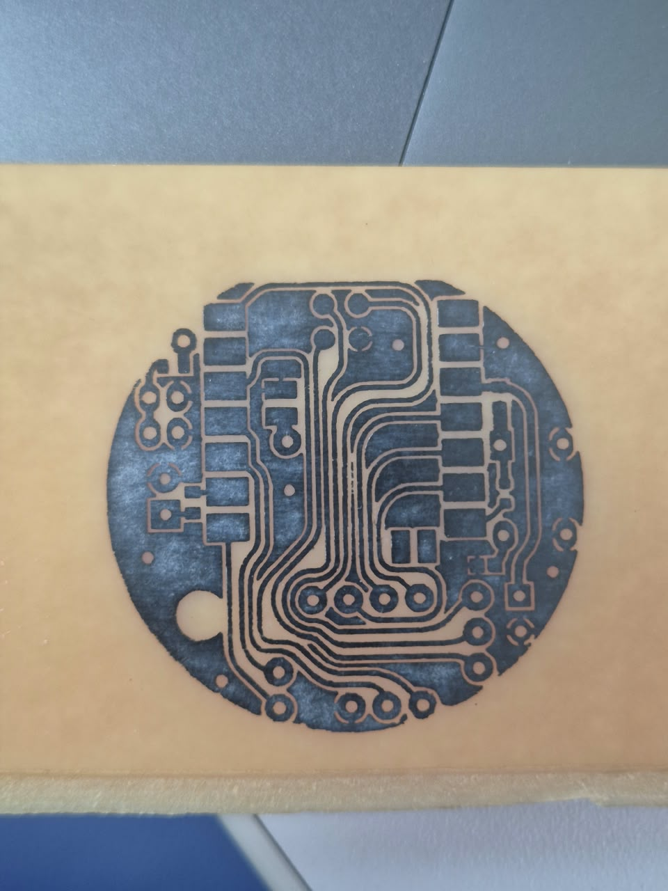
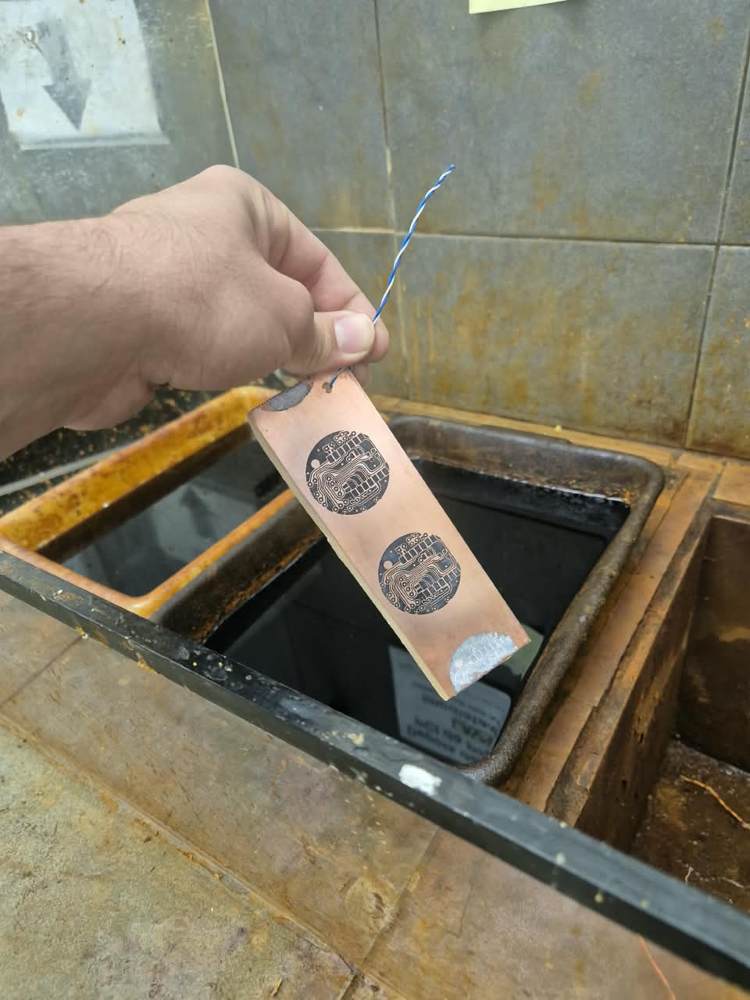
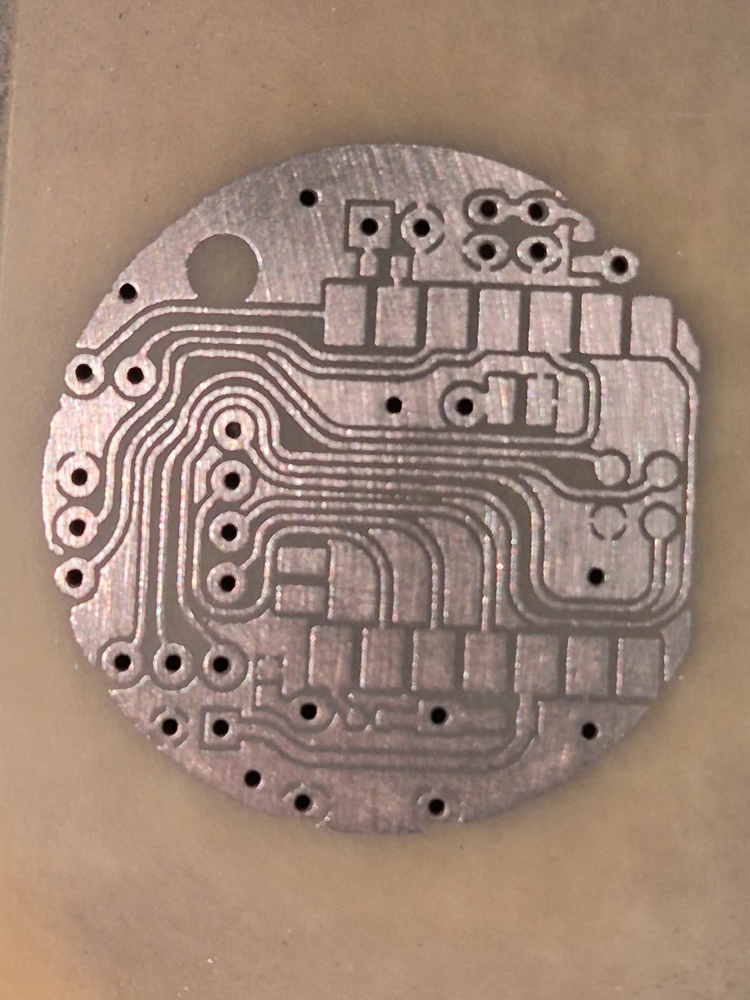
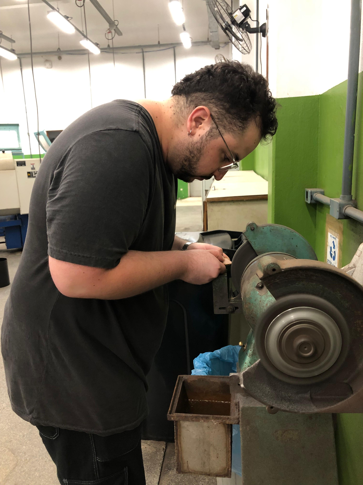
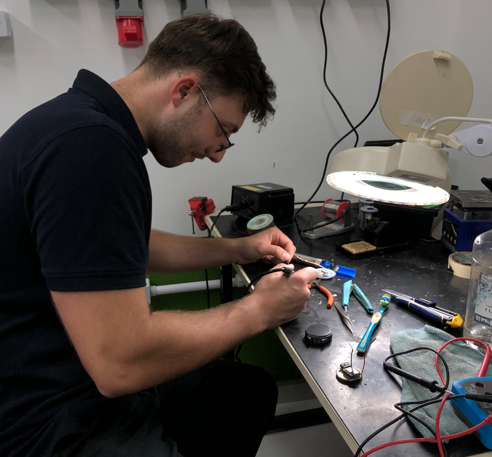
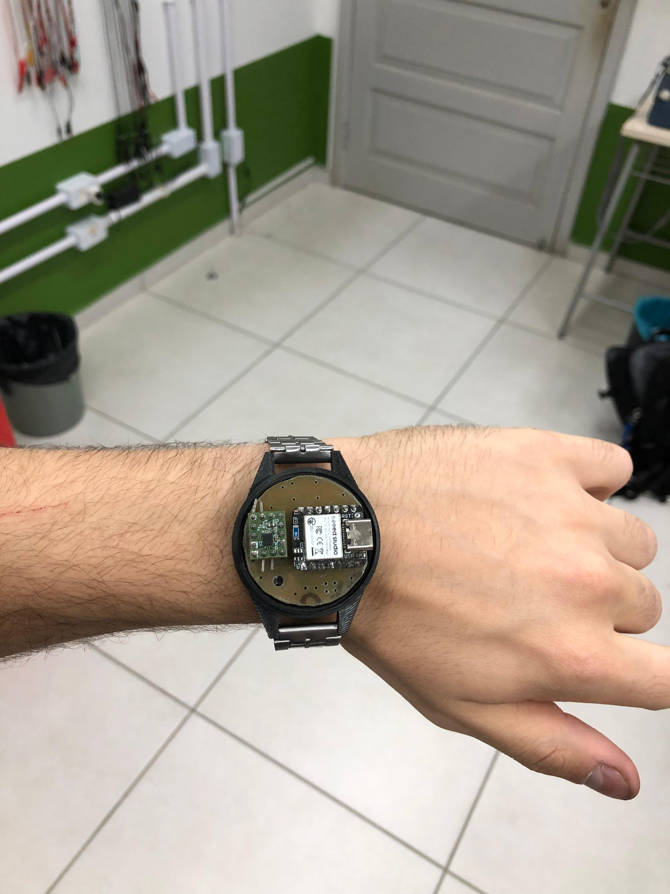

# Hardware - SysCare

## 1. Visão geral

Esta etapa apresenta o desenvolvimento do hardware da pulseira SysCare, desde a elaboração do layout da placa de circuito impresso (PCI) até os procedimentos de fabricação e preparação da placa para montagem.

A documentação registra as principais etapas do processo, incluindo o desenvolvimento do layout, a impressão, a corrosão, o lixamento, a soldagem dos componentes e a montagem do primeiro protótipo.

## 2. Desenvolvimento do layout

O layout da PCI foi desenvolvido considerando a disposição dos componentes eletrônicos e as conexões necessárias para a implementação do circuito da pulseira SysCare.

Esta etapa é importante para organizar os componentes e definir as trilhas de cobre que realizarão as conexões elétricas entre eles.

  
  
  
  
Figura 1 - Esquemático e layout projetado da Pulseira SysCare

## 3. Fabricação da PCI

Após o desenvolvimento do layout, foram realizados os procedimentos necessários para transferir o desenho para a placa e preparar o circuito impresso.

### 3.1 Impressão do layout

A impressão corresponde à etapa de preparação do desenho que será transferido para a placa de circuito impresso.

  
  
Figura 2 - Impressão utilizada no processo de fabricação da PCI

### 3.2 Corrosão do cobre

Nesta etapa, o processo de corrosão é utilizado para remover o cobre das regiões não protegidas pelo desenho do circuito, formando as trilhas e as áreas condutoras definidas no layout.

  
  
Figura 3 - Processo de corrosão da placa de circuito impresso

### 3.3 Resultado após a corrosão

Após o processo de corrosão, a placa apresenta as trilhas de cobre correspondentes ao desenho transferido para a PCI.

  
  
Figura 4 - Placa de circuito impresso após o processo de corrosão

### 3.4 Lixamento da placa

O lixamento foi realizado para ajustar o tamanho da placa e fazer os cortes laterais para o encaixe na parte mecânica.

  
  
Figura 5 - Adequação da placa por lixamento

### 3.5 Soldagem dos componentes

Após o lixamento, foi feita a soldagem dos componentes. Para os testes iniciais, foram soldados apenas o XIAO nRF52840, o acelerômetro IIM-42351 e a bateria.

  
  
Figura 6 - Soldagem dos componentes na PCI

### 3.6 Montagem do primeiro protótipo

Após a soldagem, a placa foi montada na carcaça, formando o primeiro protótipo. A Figura 7 apresenta a montagem integrada à parte mecânica da pulseira.

  
  
Figura 7 - Primeiro protótipo da pulseira SysCare

