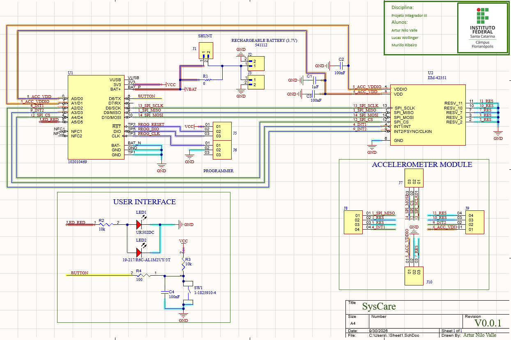
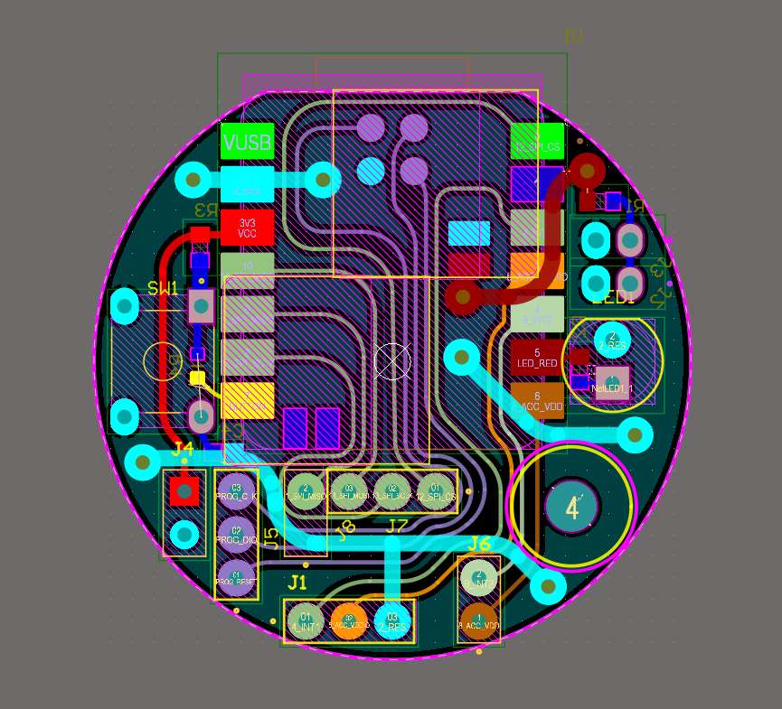
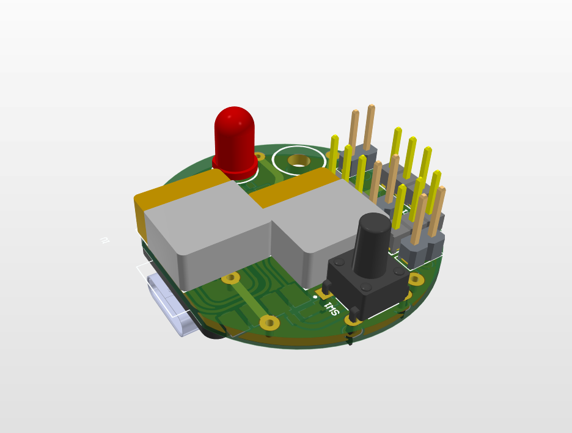
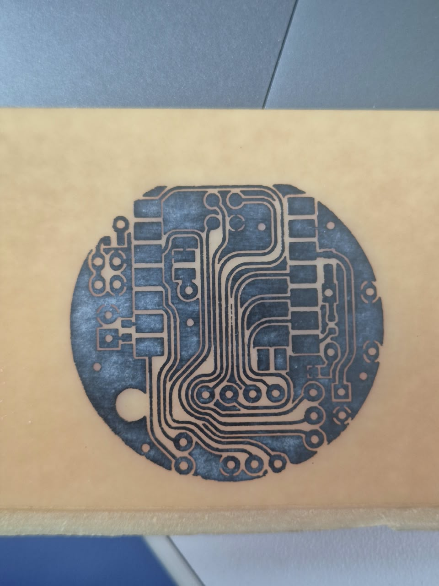
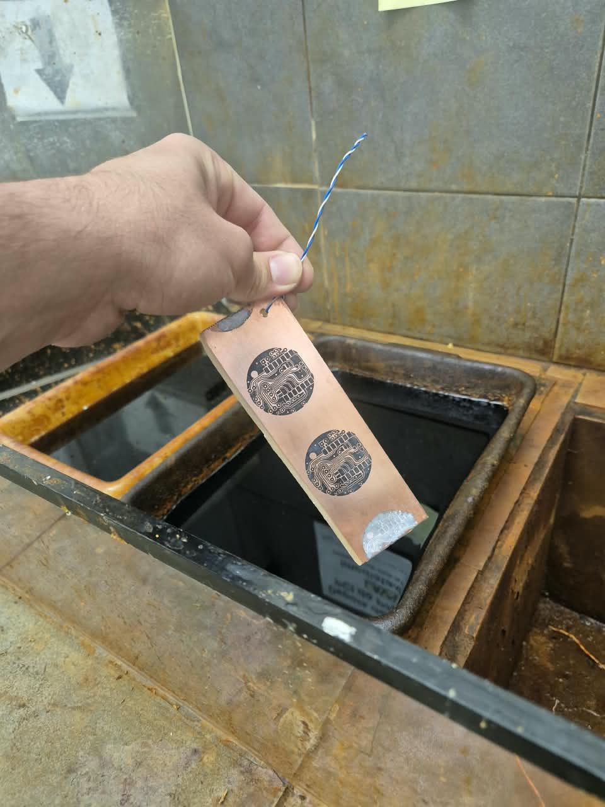
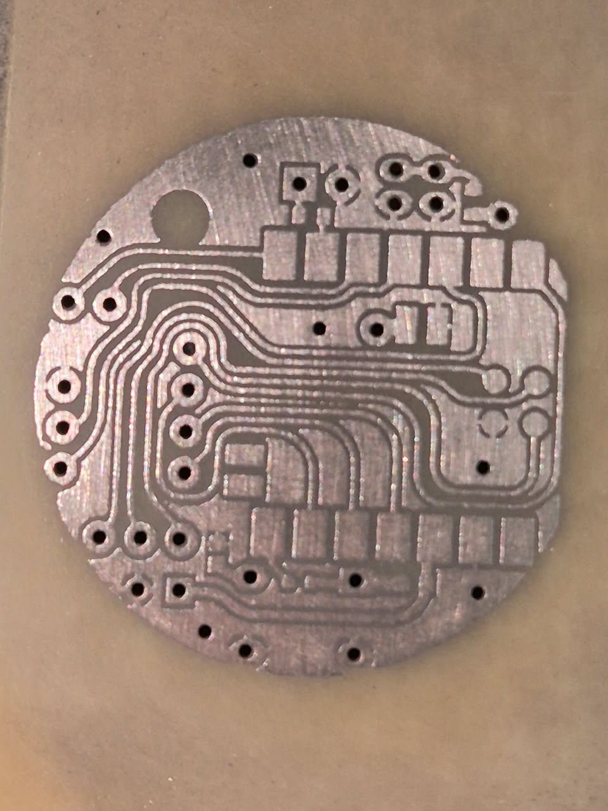
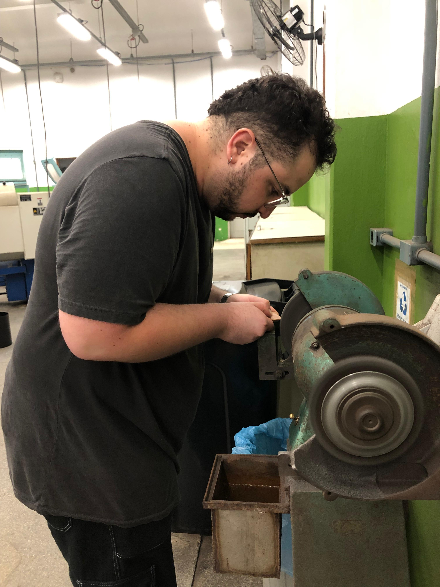

# Hardware - SysCare

## 1. Visão geral

Esta etapa apresenta o desenvolvimento do hardware da pulseira SysCare, desde a elaboração do layout da placa de circuito impresso (PCB) até os procedimentos de fabricação e preparação da placa para montagem.

A documentação registra as principais etapas do processo, incluindo o desenvolvimento do layout, a impressão, o lixamento e o processo de corrosão da placa.

## 2. Desenvolvimento do layout

O layout da PCB foi desenvolvido considerando a disposição dos componentes eletrônicos e as conexões necessárias para a implementação do circuito da pulseira SysCare.

Esta etapa é importante para organizar os componentes e definir as trilhas de cobre que realizarão as conexões elétricas entre eles.

  
  
  
  
Figura 1 - Layout Projetado da Pulseira Syscare

## 3. Fabricação da PCB

Após o desenvolvimento do layout, foram realizados os procedimentos necessários para transferir o desenho para a placa e preparar o circuito impresso.

### 3.1. Impressão do layout

A impressão corresponde à etapa de preparação do desenho que será transferido para a placa de circuito impresso.

  
  
Figura 2 - Impressão utilizada no processo de fabricação da PCB

### 3.2. Corrosão do cobre

Nesta etapa, o processo de corrosão é utilizado para remover o cobre das regiões não protegidas pelo desenho do circuito, formando as trilhas e as áreas condutoras definidas no layout.

  
  
Figura 3 - Processo de corrosão da placa de circuito impresso

### 3.3. Resultado após a corrosão

Após o processo de corrosão, a placa apresenta as trilhas de cobre correspondentes ao desenho transferido para a PCB.

  
  
Figura 4 - Placa de circuito impresso após o processo de corrosão

### 3.4. Lixamento da placa

O lixamento foi realizado para preparar o tamanho correto e cortes laterais para o encaixe com a parte mecânica.

  
  
Figura 5 - Adequação da placa por lixamento

## 4. 

