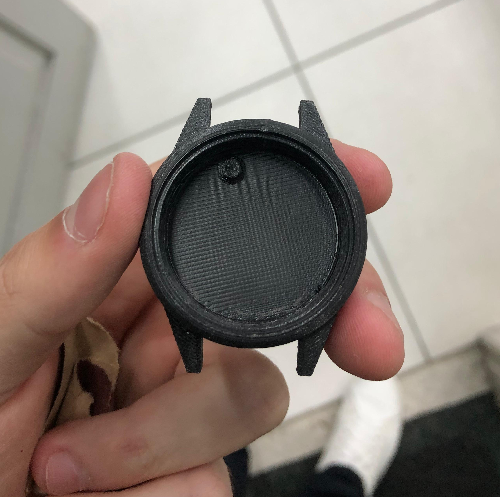
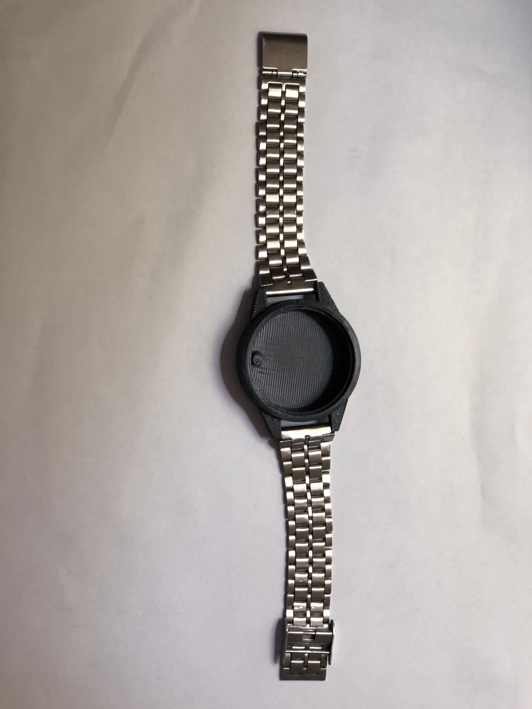
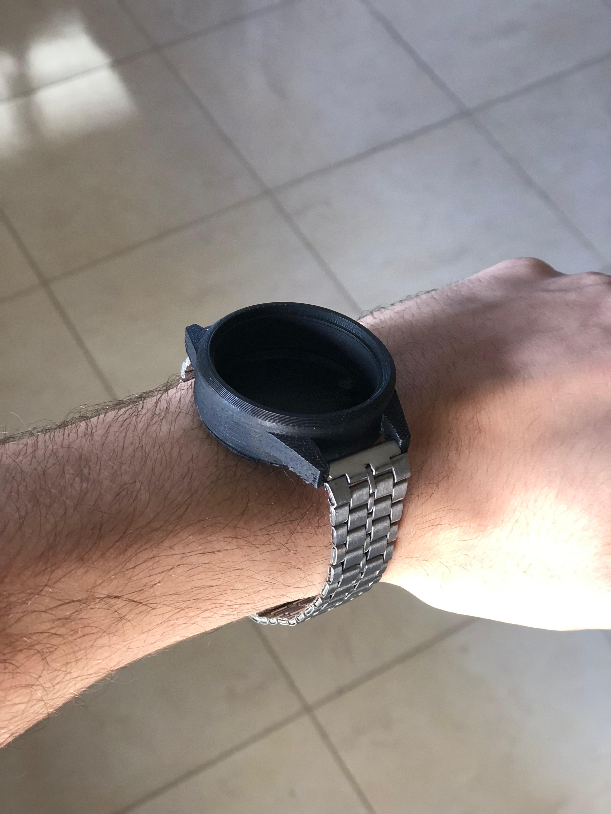

# Desenvolvimento do Case

Nesta etapa, foi realizada a fabricação da estrutura mecânica desenvolvida na etapa anterior, com o objetivo de materializar o modelo tridimensional da Pulseira SysCare e verificar sua adequação às dimensões e características definidas no projeto.

A carcaça foi produzida por meio de impressão 3D utilizando ABS, conforme definido na Etapa 2. A escolha do material foi mantida devido às características mecânicas consideradas no desenvolvimento do protótipo, além da disponibilidade do filamento e do processo de fabricação no IFSC. A utilização da impressão 3D também permite realizar alterações na geometria da estrutura de forma rápida, caso sejam identificadas necessidades de ajuste durante a montagem e integração dos componentes.

A Figura 1 a estrutura principal impressa com ABS, enquanto a Figura 2 apresenta a montagem das partes que compõem o case da juntamente com a pulseira.

Figura 1 - Estrutura do case da Pulseira SysCare produzida por impressão 3D.

  
  
  
Figura 2 - Montagem das partes do case da Pulseira SysCare.

A fabricação permitiu verificar fisicamente a geometria desenvolvida, incluindo as dimensões externas, a região destinada à acomodação dos componentes eletrônicos e os elementos de fixação da pulseira. O protótipo também possibilita a realização das próximas etapas de integração entre a estrutura mecânica, a PCI, a bateria, o acelerômetro e o microcontrolador.
