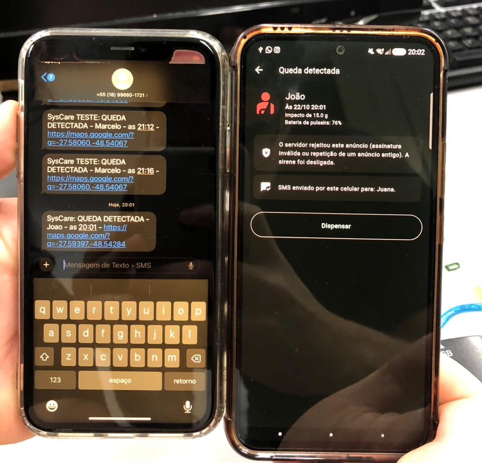

# Software

Na Etapa 3, o *software* da Pulseira SysCare saiu dos testes com dados simulados e passou a funcionar com a pulseira real. As frentes desta etapa foram o aviso remoto por *push*, para o responsável que está longe da pulseira; os ajustes revelados ao ligar o aplicativo à pulseira; e os testes de ponta a ponta. O código do aplicativo e da API foi trazido da Etapa 2 para esta pasta, de onde passa a evoluir.

> 📁 **Código e documentação técnica:** [Aplicativo](./app/README.md) · [API](./api/README.md) · **Protocolo BLE:** [ble_payload.md](./api/docs/ble_payload.md)

## Aviso remoto por *push*

Na Etapa 2, o alerta chegava aos responsáveis de duas formas: a sirene no celular que ouviu a pulseira e o SMS enviado pelo plano desse mesmo celular. Faltava atender o responsável que tem o aplicativo, mas está longe da pessoa e fora do alcance do Bluetooth. Para ele foi implementado o *push* pelo Firebase Cloud Messaging (FCM) [1], que não cobra por mensagem e já estava previsto na arquitetura da API.

O celular que ouve a pulseira repassa o evento à API, que confere a assinatura do anúncio e envia o *push* aos celulares registrados pelos responsáveis daquela pulseira. O celular do responsável toca a mesma sirene do alarme local e abre a tela do alerta. As decisões estão na Tabela 1.

| Aspecto | Decisão |
|---|---|
| **Quem recebe** | Os responsáveis vinculados à pulseira pelo código de responsável, exibido na tela Conta do aplicativo. Quem é cadastrado só com telefone recebe apenas o SMS |
| **Registro** | Depois do *login*, o celular registra na API o seu identificador do Firebase e o remove ao sair da conta |
| **Formato** | No Android, a mensagem leva apenas dados, para que o próprio aplicativo, mesmo fechado, dispare a sirene insistente no canal de alarme [2] |
| **Repetição** | A mensagem traz a identificação da pulseira e o número de sequência do anúncio; se o celular já ouviu o mesmo evento pelo rádio, o *push* é ignorado |
| **Configuração** | As chaves do Firebase ficam fora do repositório. Sem elas, o aplicativo e a API funcionam normalmente, só sem *push*, e a tela Saúde do sistema indica a situação |

  
Tabela 1 - Decisões do aviso por <i>push</i>

## Ajustes encontrados na integração

Ligar o aplicativo à pulseira real revelou problemas que os testes com dados simulados não mostravam.

No aplicativo, a biblioteca de Bluetooth usada no Flutter [3] configura o Android, por padrão, para procurar o anúncio estendido do BLE 5, enquanto a pulseira usa o anúncio legado de 31 bytes, escolhido pela compatibilidade com celulares antigos. A varredura passou a pedir explicitamente o formato legado [4], e um novo teste automatizado reproduz o caminho completo com os bytes reais transmitidos pela pulseira, da varredura até as telas Nova pulseira e Início.

No *firmware* de referência do anúncio, o pacote era remontado a cada ciclo, mas não era reenviado ao rádio; o intervalo de repouso era de cerca de 1 s, e não os 2 s do protocolo; e a função de HMAC usada deixou de ser pública na versão 3 do nRF Connect SDK [5]. O *firmware* foi corrigido, passou a calcular a assinatura pela API PSA Crypto [6] e foi gravado na XIAO nRF52840. Ele serve de referência para o *firmware* integrado, que ainda não assina os anúncios.

> 📁 **Firmware de referência do anúncio:** [teste_ble](../../etapa_2/software/firmware/teste_ble/src/main.c)

## Testes

Além dos testes automatizados, o sistema foi testado com a pulseira executando o *firmware* de testes da Etapa 3, que transmite um *heartbeat* a cada 10 s e simula uma queda a cada 60 s. Os resultados estão na Tabela 2.

| Teste | Como foi feito | Resultado |
|---|---|---|
| **Automatizados** | 47 testes do aplicativo e 27 da API, incluindo o *push* e a recepção com os bytes reais da pulseira | Todos aprovados |
| **Pulseira → aplicativo** | Celular Android com a escuta ligada, próximo da pulseira | O aplicativo reconheceu a pulseira, exibiu a bateria e o impacto transmitidos e disparou a sirene na queda simulada |
| **SMS** | Responsável cadastrado com telefone | O SMS com o link do mapa chegou ao celular do responsável |
| **Assinatura** | Quedas do *firmware* de testes, que ainda não assina o anúncio | A API recusou o evento, e o aplicativo desligou a sirene e informou a recusa |
| ***Push*** | Alerta assinado gerado pelo *script* de simulação da API | O celular do responsável recebeu o alerta com a sirene de alarme |

  
Tabela 2 - Testes do <i>software</i> na Etapa 3

A Figura 1 mostra o teste com a pulseira. À direita, o celular que ouviu o anúncio exibe a queda, o impacto e a bateria transmitidos, a recusa do servidor e o SMS enviado. À esquerda, o celular do responsável mostra o SMS recebido.

  
  
Figura 1 - Teste de 22/10/2026: queda simulada pela pulseira, alarme no celular que a ouviu e SMS recebido pelo responsável

A recusa do servidor é o comportamento esperado: sem o HMAC [7], a API não distingue a pulseira de um rádio que imite o anúncio. A sirene e o SMS saem antes da resposta do servidor, por projeto, e por isso funcionaram mesmo assim. Para fechar a cadeia da pulseira ao *push*, falta o *firmware* integrado assinar o anúncio com a chave gerada no cadastro, como já faz o *firmware* de referência.

## Próximos passos

- Assinar o anúncio no *firmware* integrado e guardar o número de sequência na memória da pulseira, para que ele não volte a zero a cada reinício.
- Manter a escuta com a tela do celular apagada, por meio de um serviço em primeiro plano.
- Parar a sirene dos demais responsáveis quando um deles confirma o atendimento.

## Referências (links/datasheets/livros)

- [1] [GOOGLE. Firebase Cloud Messaging - Documentation](https://firebase.google.com/docs/cloud-messaging)

- [2] [GOOGLE. Receive messages in Flutter apps - Firebase Cloud Messaging](https://firebase.google.com/docs/cloud-messaging/flutter/receive)

- [3] [NAVIDECK. universal_ble - Flutter plugin for Bluetooth Low Energy](https://pub.dev/packages/universal_ble)

- [4] [ANDROID DEVELOPERS. ScanSettings.Builder - setLegacy](https://developer.android.com/reference/android/bluetooth/le/ScanSettings.Builder)

- [5] [NORDIC SEMICONDUCTOR. nRF Connect SDK - Documentation](https://docs.nordicsemi.com/bundle/ncs-latest/page/nrf/index.html)

- [6] [ARM. PSA Certified Crypto API](https://arm-software.github.io/psa-api/crypto/)

- [7] [KRAWCZYK, H.; BELLARE, M.; CANETTI, R. RFC 2104 - HMAC: Keyed-Hashing for Message Authentication](https://datatracker.ietf.org/doc/html/rfc2104)
