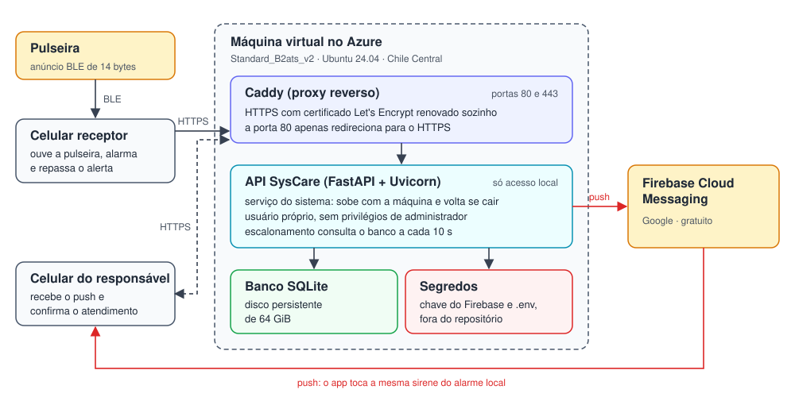

# Servidor na nuvem

Até a Etapa 2, a API rodava no computador de desenvolvimento e só era alcançada pelos celulares da mesma rede Wi-Fi. Para que o alerta chegue ao servidor de qualquer lugar e o *push* alcance os responsáveis onde estiverem, a API foi publicada em uma máquina virtual do Azure, com HTTPS e endereço fixo: [syscare-pi3.chilecentral.cloudapp.azure.com](https://syscare-pi3.chilecentral.cloudapp.azure.com/health). Este documento registra os requisitos, as opções avaliadas, a implantação e os testes. Os planos gratuitos citados foram consultados entre outubro e novembro de 2026.

> 📁 **Arquivos de configuração do servidor, sem os segredos:** [deploy](../deploy/)

## 1. Requisitos

Dois detalhes da API pesaram mais do que o custo. O escalonamento, que reenvia o alerta enquanto nenhum responsável confirma, roda dentro do processo da API e consulta o banco a cada 10 s; por isso, o servidor precisa ficar sempre ligado. Além disso, o banco SQLite é um arquivo e precisa de disco persistente. Os requisitos estão na Tabela 1.

| Requisito | Motivo |
|---|---|
| **Sempre ligado** | Um serviço que "dorme" atrasa o primeiro alerta e interrompe o escalonamento |
| **Disco persistente** | O SQLite guarda contas, pulseiras e alertas em um arquivo |
| **HTTPS** | Senhas e sessões dos usuários trafegam pela internet |
| **Custo zero** | Projeto acadêmico, sem orçamento para infraestrutura |

  
Tabela 1 - Requisitos do servidor

## 2. Opções avaliadas

As plataformas que publicam a aplicação a partir do repositório são as mais simples, mas seus planos gratuitos desligam o serviço por inatividade: o Render após 15 minutos, levando cerca de 1 minuto para religar [1], e o Koyeb após 1 hora [2]. Elas também não preservam arquivos entre reinícios, o que exigiria um banco externo. Já o Neon, banco PostgreSQL gratuito, limita o uso a 100 horas de computação por mês [3], que a consulta a cada 10 s esgotaria em cerca de 16 dias. As máquinas virtuais atendem a todos os requisitos sem alterar o código (Tabela 2).

| Opção | Sempre ligado | Banco | Custo e acesso | Situação |
|---|:---:|---|---|---|
| **Azure for Students** [4] | Sim | SQLite no disco da máquina | Crédito de US$ 100 para estudantes, sem cartão | **Escolhida** |
| **Oracle Cloud Always Free** [5, 6] | Sim | SQLite no disco da máquina | Gratuito, exige cartão; limites reduzidos em 2026 | Alternativa |
| **Google Cloud e2-micro** [7] | Sim | SQLite no disco da máquina | Gratuito, exige cartão; somente regiões dos EUA | Alternativa |
| **Render ou Koyeb, com Neon** [1, 2, 3] | Não | PostgreSQL externo | Gratuito | Descartada |

  
Tabela 2 - Opções de hospedagem avaliadas

O Azure for Students foi escolhido por não exigir cartão e cobrir o restante do projeto.

## 3. Implantação

A assinatura de estudante libera apenas cinco regiões, e nenhuma delas fica no Brasil. Foi escolhida a Chile Central, a mais próxima. Por falta de capacidade na zona 1 da região, a máquina foi criada na zona 2. A configuração está na Tabela 3.

| Item | Configuração |
|---|---|
| **Máquina** | Standard_B2ats_v2: 2 vCPU AMD com desempenho base de 20% e 1 GiB de memória [8] |
| **Sistema** | Ubuntu Server 24.04 LTS, com 1 GiB de memória de troca em disco |
| **Disco** | SSD Premium de 64 GiB |
| **Rede** | Endereço público com nome no domínio do Azure; portas 22, 80 e 443 |
| **Acesso administrativo** | SSH somente por chave; login por senha desativado |

  
Tabela 3 - Configuração da máquina virtual

A organização dos serviços, apresentada na Figura 1, segue a recomendação da documentação do FastAPI [9]: a aplicação não fica exposta diretamente, mas atrás de um *proxy* reverso que trata o HTTPS, e um gerenciador de processos a inicia junto com a máquina e a reinicia em caso de falha. O *proxy* é o Caddy, que obtém e renova sozinho o certificado do Let's Encrypt [10, 11] e redireciona a porta 80 para o HTTPS. O gerenciador é o systemd [12], que executa a API com um usuário próprio, sem privilégios de administrador e com permissão de escrita apenas na pasta do banco.

  
  
Figura 1 - Organização do servidor na nuvem e caminho do alerta até o responsável

A chave do Firebase e o arquivo de configuração ficam no servidor, legíveis apenas pelo usuário da API, e não vão para o repositório. A chave que assina as sessões dos usuários foi gerada no próprio servidor. O banco de testes foi copiado para a máquina, com as contas e as pulseiras.

## 4. Testes

Os testes da Tabela 4 foram feitos do computador de desenvolvimento, exceto o último, feito com a pulseira em 04/11/2026.

| Verificação | Resultado |
|---|---|
| **Saúde da API por HTTPS** | Resposta 200, em modo de produção e com o *push* ativo |
| **Certificado** | Emitido pelo Let's Encrypt, válido até 31/01/2027 e renovado automaticamente |
| **Acesso por HTTP** | Redirecionado para HTTPS |
| **Login com credenciais inválidas** | Recusado, confirmando o caminho completo até a API |
| **Tempo de resposta** | Cerca de 230 ms por requisição, incluindo a abertura da conexão segura |
| **Reinício da máquina** | API e HTTPS de volta em cerca de 18 s, sem intervenção |
| **Pulseira e aplicativos** | Queda aceita e *push* confirmado por um responsável em outra rede em menos de 30 s |

  
Tabela 4 - Testes do servidor

## 5. Custos e próximos passos

A máquina custa US$ 0,0132 por hora no preço de tabela, cerca de US$ 10 por mês descontados do crédito de estudante, ou nada, se estiver coberta pelas horas gratuitas da oferta. Como a assinatura não tem cartão, quando o crédito acaba a máquina é desligada, sem cobrança.

- **Aplicativo:** aceitar o endereço do servidor sem a porta 443; hoje o aplicativo assume a porta 8000 quando ela falta, e a porta precisa ser digitada.
- **Cópia de segurança:** copiar o banco diariamente para fora da máquina, onde hoje está a única cópia.
- **Acesso administrativo:** restringir a porta do SSH, hoje aberta à internet, embora só aceite chave.

## Referências (links/datasheets/livros)

**Hospedagem**

- [1] [RENDER. FAQ](https://render.com/docs/faq)

- [2] [KOYEB. Scale-to-Zero](https://www.koyeb.com/docs/run-and-scale/scale-to-zero)

- [3] [NEON. What are the limits and quotas for Neon's Free plan?](https://neon.com/faqs/free-plan-limits-and-quotas)

- [4] [MICROSOFT. Azure for Students](https://azure.microsoft.com/en-us/free/students)

- [5] [ORACLE. Always Free Resources](https://docs.oracle.com/en-us/iaas/Content/FreeTier/resourceref.htm)

- [6] [INFOQ. Oracle Quietly Halves Free Tier Ampere A1 Compute Limits with No Public Announcement](https://www.infoq.com/news/2026/07/oracle-cloud-free-tier-limits/)

- [7] [GOOGLE CLOUD. Documentação do programa gratuito (Free Tier)](https://docs.cloud.google.com/free/docs/free-cloud-features)

- [8] [MICROSOFT. Basv2 size series - Azure Virtual Machines](https://learn.microsoft.com/en-us/azure/virtual-machines/sizes/general-purpose/basv2-series)

**Implantação**

- [9] [FASTAPI. Deployments Concepts](https://fastapi.tiangolo.com/deployment/concepts/)

- [10] [CADDY. Automatic HTTPS](https://caddyserver.com/docs/automatic-https)

- [11] [LET'S ENCRYPT. How It Works](https://letsencrypt.org/how-it-works/)

- [12] [SYSTEMD. systemd.service - Service unit configuration](https://www.freedesktop.org/software/systemd/man/latest/systemd.service.html)
